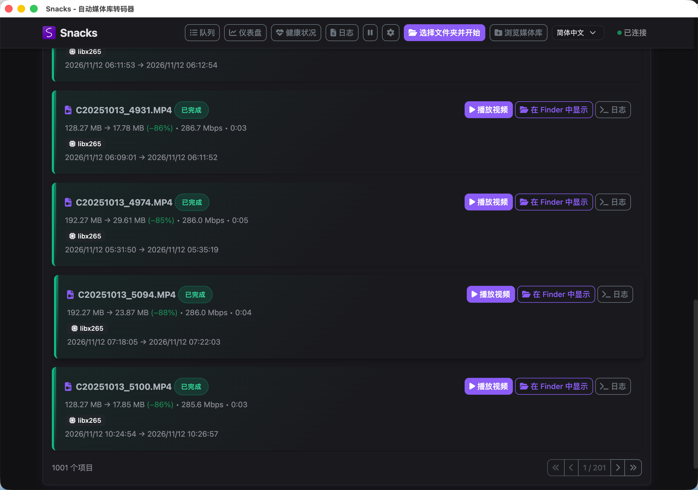

# Snacks 归档版

我是个小白，主要想给自己的拍摄素材省点硬盘空间。当时我用的 Snacks 没有合适的中文界面，所以让 **Codex 帮我汉化，再按自己的素材归档需求魔改**。目前的标准就是在我自己的机器和素材上能跑通，先解决自己的问题；别把它当成已经打磨成熟的通用产品。

> **优先让 Codex 等智能体帮你配置和调用这个项目。** 我不建议和我一样的小白直接自行安装后就批量跑原片。让智能体先读文档、核对电脑环境和下面的规则，再拿素材副本跑一小批，确认结果后才批量处理。

当前版本：**2.20.4**。这是基于 [Derek Morris / derekshreds 的 Snacks v2.20.1](https://github.com/derekshreds/Snacks/tree/v2.20.1) 修改的独立派生版；上游 MIT 许可证与署名完整保留，见 [来源说明](docs/UPSTREAM.md)。

## 我的转码逻辑：当前目标上限 20 Mbps

下面是我当前使用的**自定义归档模式**，目标上限设为 **20 Mbps**，也与这版源码默认值一致。优先读取**输入视频流的码率**，缺失时会估算；进入转码的素材输出为 H.265 / HEVC：

| 输入编码 | 分界值 | 低于分界值 | 等于或高于分界值 |
| --- | ---: | --- | --- |
| **H.265 / HEVC** | **25 Mbps** | **跳过，保持原样** | **转码，规则目标 20 Mbps** |
| H.264 / AVC | 40 Mbps | 转码，目标为源码率 ÷ 2 | 转码，规则目标 20 Mbps |
| MPEG-2 | 80 Mbps | 转码，目标为源码率 ÷ 4 | 转码，规则目标 20 Mbps |
| ProRes | 680 Mbps | 转码，目标为源码率 ÷ 34 | 转码，规则目标 20 Mbps |
| DNxHR | 660 Mbps | 转码，目标为源码率 ÷ 33 | 转码，规则目标 20 Mbps |

比如：H.265 的 24 Mbps 不动、**25 Mbps 就进入 20 Mbps 目标的转码**；H.264 的 30 Mbps 对应目标 15 Mbps，100 Mbps 对应目标 20 Mbps。它不是“所有素材一律压到 20”。普通 DNxHD 等尚未配置规则的编码会跳过。

**另有一道与码率无关的门槛：源文件小于 10 MB（10,000,000 字节）直接跳过。** 恰好等于 10,000,000 字节会继续按上表判断；这里的 MB 是文件大小，不是 Mbps。

目标上限可调：设为 `T` 时，HEVC 的跳过边界是 `1.25 × T`，其余编码先按上面的除数计算，再与 `T` 取较小值。无法得到有效视频码率、带透明通道，或封装/规格/元数据布局不受支持时，也会跳过。

表里是**编码目标，不是实际输出码率的硬保证**。程序还会留约 2% 的编码余量（20 Mbps 目标实际请求 19.6 Mbps），短片等素材仍可能高于目标。原位替换会改动源文件，先保留独立备份，再用副本试跑。

## 我发现的一点：有些索尼 H.265 短片，空间并不全花在画面上

我之前怀疑部分索尼素材存在很大的容器占位。2026-11-02 核对的 **3 条约半秒 HEVC 短片**支持了这个观察：每条约 **64.26 MiB**，其中约 **55.94–56.05 MiB（约占文件体积的 87%）**的 `mdat` 空间没有被任何轨道采样表引用；对尾部的 9 处抽样均为零，但没有逐字节扫描整段。

这三条经过**转码 + 重封装**后变为 **2.51–2.80 MiB**。这次体积收益有两部分：去掉未引用的容器占位/填充，以及有损重新编码。不能把约 96% 的整文件缩小全归因于降低视频码率，也不能说是视觉无损。**这只是三条特定短片的观察，不代表所有索尼 H.265 文件；也没有单独验证仅无损重封装能达到同样降幅。** [匿名样本与核对边界](docs/sony-hevc-storage-observation.md)。

## 我目前跑出来的界面



这是 **2026-11-12 的另一批素材**，几条记录显示体积减少约 **85%–88%**，只代表这些运行个例。界面里的约 **286 Mbps 是输入视频码率，不是成片码率**；这张截图也不是上面三条容器填充样本的检测证据。

## 可以这样交给智能体

复制下面这段，再提供你自己的素材位置与需求：

```text
请先阅读这个项目的 README 和 docs/BUILDING.md，核对我的操作系统、
工具环境、素材编码/源码率，以及当前自定义归档规则。
帮我选择合适的本地运行方式，通过命令行、HTTP 接口或桌面流程配置/调用。
先用独立工作目录和少量素材副本跑通，检查结果、输出位置、原位替换和备份设置，
再决定是否批量处理；不要接入或继续其他正在运行的队列。
不要上传我的素材、配置或凭据。
```

这还是一个本地源码、命令行启动、HTTP 接口与桌面应用组成的工作流，**没有专用 MCP 服务或一键智能体插件**。智能体也需要先读规则和检查环境，不能替你保证素材安全或画质。

## 可选：下载与安装

从本仓库 [Releases](https://github.com/shiziyang2000-bit/snacks-archive/releases) 下载 DMG、中文安装说明和 SHA256 校验清单。

| 平台 | 本分支状态 |
| --- | --- |
| Apple 芯片 Mac、macOS 26 或更新 | 当前提供的 arm64 DMG；已在 macOS 26.6.2 验证媒体工具与隔离后端启动 |
| Intel Mac、Windows、Linux / Docker | 保留上游相关源码；本分支未完成对应安装包实测，不提供兼容承诺 |

DMG 包含 FFmpeg、ffprobe、自包含 .NET 10 运行时，以及 Sony MP4 特定元数据处理所需的 MP4Box 与依赖，不需要用户安装 Homebrew 或 .NET。拖入“应用程序”后运行。

当前 DMG 是 **ad-hoc 本地签名，未使用 Apple Developer ID，也未经过 Apple 公证**。首次被系统拦截时，可在尝试打开后进入“系统设置 → 隐私与安全性 → 仍要打开”。组织策略或其他 Gatekeeper 提示可能仍会阻止运行；不要全局关闭系统安全保护。详见随包安装说明。

## 已确认环境后的使用步骤

首次安装会创建空队列和当前用户自己的配置，不包含开发者的任务、素材或账号。已用过同名归档版时，会继续使用该机器已有的用户数据。

1. 先复制少量素材作为测试，确认输出格式、编码和文件处理参数。
2. 通过程序内的文件夹选择器选择自己的素材目录。
3. 检查队列、完成与失败记录，再逐步处理正式素材。

**归档模式支持原位替换源文件。** 是否替换以及是否保留额外备份取决于任务设置；不要将“有异常保护”理解为“不会修改原片”。处理重要素材前保留独立备份，并检查输出位置与替换选项。

macOS 用户数据位于 `~/Library/Application Support/Snacks-Archive/`，与上游 Snacks 的资料目录隔离。构建脚本不会启动、安装或更新正在运行的应用。

## 相对上游的主要更改

- 独立的“Snacks 归档版”身份与简体中文 / English 菜单、界面。
- 面向文件夹的归档任务、持久化历史、受保护的原位替换事务与恢复处理。
- 有界并行与持续补位；确认属于单文件的权限、锁定等异常单独记录，避免阻塞整个目录。
- 实时归档容量、转码时长与统计覆盖率显示，以及文件定位等原生桌面操作。
- 对已识别的 Sony MP4 `rtmd` / 时间码关联路径进行针对性保留；不承诺支持所有相机或元数据布局。
- 分发包使用包内 MP4Box 路径；macOS 26 最低要求与本包原生依赖一致。

上游视频、音频、集群与第三方服务功能的源码仍保留；归档版的实测重点是本地 Apple 芯片 Mac 工作流。

## 构建与测试

需要 .NET 10 SDK、Node.js 22+。先运行源码检查：

```bash
npm --prefix electron-app ci
npm --prefix electron-app run check
dotnet test Snacks.Tests/Snacks.Tests.csproj --configuration Release
```

Apple 芯片 Mac 的打包还需要 macOS 26+、Xcode 命令行工具、GPAC，以及自行取得并解包的上游官方 v2.20.1 arm64 App 资源：

```bash
export SNACKS_ORIGINAL_APP="/path/to/upstream/Snacks.app"
export SNACKS_MP4BOX="$(brew --prefix gpac)/bin/MP4Box"
bash build-cn-mac.sh --check
bash build-cn-mac.sh
```

每次打包使用独立临时构建目录，默认只做 ad-hoc 签名，不公证、不推送 GitHub、不安装 App。完整参数、资源来源与验证范围见 [构建说明](docs/BUILDING.md)。本仓库不携带 node_modules、媒体工具二进制、SDK 或运行资料。

现有前端测试共 38 项。初始公开准备验证了这些测试、新增 MP4Box 依赖打包与合成媒体处理；没有把静态语法检查称为完整重建。已发布 DMG 的来源与实测边界见 [2.20.4 分发记录](docs/RELEASE-v2.20.4.md)。

## 贡献与许可

问题与改进建议请在[本仓库 Issues](https://github.com/shiziyang2000-bit/snacks-archive/issues)提出。提交日志或配置前请去掉媒体路径、服务地址、账号与凭据。

Snacks 原代码：Copyright (c) 2026 Derek Morris，采用 [MIT License](LICENSE)。归档版修改作为同一 MIT 项目的派生代码公开；FFmpeg、GPAC、Electron、.NET 与其他第三方组件仍适用各自许可证。保留的上游截图、图标和字体来自原项目；本文新增的归档运行截图由我提供。
